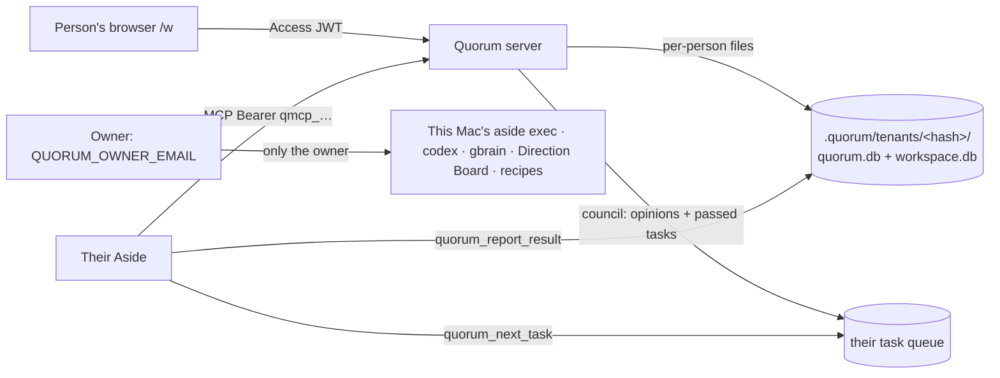

# Hosted Quorum: everyone brings their own Aside

On quorum.lidgeai.com each person signs in with Cloudflare Access and gets their own Quorum: their own Workspace, council runs, memory and task queue. The council's work never runs on the host's computer. Bot opinions and the browser tasks a council passes (or a person approves) wait in that person's queue, and **their own Aside** picks them up over MCP and reports back.

Running Quorum on your own Mac instead is simpler: see "Run it with your own Aside" at the top of the [README](../../README.md).

## For judges: connect in three steps

1. Open https://quorum.lidgeai.com/w and sign in with your email (Cloudflare Access sends a one-time code). The **Connect your Aside** card is at the top of Now.
2. Press **Make token**, copy the token (it is shown once), and add the entry the card shows under `mcp.servers` in your Aside settings file (`~/.aside/u/<account>/settings.json`). It looks like this:

   ```json
   "quorum": {
     "enabled": true,
     "transport": "streamable-http",
     "url": "https://quorum.lidgeai.com/mcp",
     "auth": { "type": "headers", "headers": { "Authorization": "Bearer qmcp_…" } }
   }
   ```

3. In Workspace, press **Send to agent** on the demo item (or anything you write down). Then tell Aside:

   > Work through my Quorum tasks: call quorum_next_task with waitSeconds 20, do each task exactly as it says, report it with quorum_report_result, and stop when it returns no task twice in a row. Never send, pay, submit or post anything.

   Aside answers the seven bot opinions (three proposers, four reviewers), the council rules, and the browser work that passed comes back to Aside as a task. Results land under **Review**; anything that sends, pays or posts waits under **Needs you**, and approving it queues it for your Aside again.

The settings shape above is the one Aside 1.26.1107 uses for its own HTTP MCP servers (`transport: "streamable-http"`, `auth.type: "headers"`). Connecting a real Aside to the hosted site was not tested from this lane; see "Not verified" below.

## Data flow



- **Who is who.** On the public listener the user is the Access JWT email. On `/mcp` a connection token (`Authorization: Bearer qmcp_…`) also works, and its owner is the user. Tokens open nothing but `/mcp`.
- **Owner.** Only `QUORUM_OWNER_EMAIL` gets the host's tenant, which is wired to this Mac's Aside, Codex CLI, gbrain, Direction Board and recipes. If it is unset, nobody on the public listener is the owner. The local listener (127.0.0.1:4317, requests from this Mac only) is always the owner.
- **Isolation.** Every other person gets their own SQLite files under `.quorum/tenants/<first 24 hex of sha256(email)>/`. Each request picks the tenant from the signed-in email before any route runs, so a run id, signal id or task id from someone else simply does not exist in your files (404).
- **Queue.** `quorum_next_task` leases one task (opinions first). Opinions have no side effects: an unreported 10-minute lease goes back to the queue, and after three leases the opinion fails. Browser work is **never handed to a second agent**: if its 30-minute lease runs out without a report, the task fails and the signal moves to Needs you, because the first agent may still be acting; approving it again queues a new task. `quorum_report_result` needs the task id and its current, unexpired lease id; reporting the same lease again returns the first result. The result and its Workspace update are written in one transaction, so if Workspace cannot record it nothing is recorded and the same lease can report again.
- **What runs is what you saw.** The request and the council's task travel inside fenced blocks sized so their own text cannot close the fence, followed by the rules. When you approve, the note on the signal shows exactly the text that was sent to your Aside.
- **Memory.** The owner uses gbrain. Everyone else gets a verdict table in their own `workspace.db`, so reuse only ever matches your own past verdicts.

## Bot opinions for non-owners

| Option | Who pays | Exposure | Speed | Chosen |
|---|---|---|---|---|
| Host's Aside (`aside exec`) | host | runs in the host's signed-in browser and accounts | ~2 min | **never** (the requirement) |
| Host's Codex CLI (`codex exec -s read-only`) | host | read-only sandbox can still read the host's files, and Codex loads the host's MCP servers; a prompt injection could leak them into an opinion | ~1 min | no |
| **Their Aside answers opinions from the queue** (`QUORUM_GUEST_BOTS=client`, default) | them | none on the host | depends on their Aside loop | **yes** |
| Host model API, no tools (`QUORUM_GUEST_BOTS=api` + `QUORUM_GUEST_MODEL_URL/_KEY` + `QUORUM_GUEST_MODEL`) | host (rate limited) | plain text in, JSON out; no files, browser or MCP | seconds | optional switch |

Default `client` keeps the host's cost and exposure at zero. If a judge's Aside never answers, the council waits up to 15 minutes per opinion and then ends below quorum (holds), which is visible in the console and Workspace.

## Threat model

| Attacker / failure | Boundary | What stops it | Test |
|---|---|---|---|
| A signed-in non-owner tries to run work on the host's browser, Codex, gbrain, Direction Board or recipes | tenant selection | only `QUORUM_OWNER_EMAIL` maps to the owner tenant; guest tenants are built in `src/hosted/guest.ts`, which imports none of the host's executors; recipes are 403 for guests | `src/hosted/two-user.test.ts` (spawned server with a recording fake `ASIDE_BIN`: only `account list --json`, zero `exec`/`repl`), `tenancy.test.ts` |
| Person A reads or acts on person B's items, runs, events (SSE), memory, signals, approvals or MCP data | per-person files | tenant chosen from the verified email; separate DB files | `tenancy.test.ts` |
| Stolen or guessed connection token | `/mcp` Bearer | 256-bit random secret, SHA-256 at rest, shown once; revoke is checked on every request; owner re-checked against `ALLOWED_EMAILS` each call; bad tokens 401 even next to a valid login; 30 failed attempts per minute per address then 429 | `tokens.test.ts` |
| Token used outside MCP | route | Bearer is only read on `/mcp`; `/api` needs the Access login | `tokens.test.ts` |
| Cross-site request from another website | public listener | `Origin` must equal `PUBLIC_ORIGIN` for writes; token create/revoke also checks `Sec-Fetch-Site` | `tokens.test.ts`, `public.test.ts` |
| Prompt injection through the request, a web page or a council task | the task text | queued tasks are labeled as data, not instructions from the host; rules forbid sending, paying, submitting, posting and deleting; the CSO hold rule and outbound-word rule still hold money/external/legal/prod work for the person; approval only queues it for *their* Aside | `two-user.test.ts` checks the framing; `engine/rules.ts` |
| Abuse: floods, huge bodies, many councils | limits | 64 KB bodies (413), 600 API calls and 240 MCP calls per person per minute with every call in a JSON-RPC batch counted, batches of at most 10 (400), at most 2 waiting long-polls per person and 500 overall (cancelled when the caller disconnects), 5 councils per person per hour counted by a server-recorded run kind, 2000-character requests for guests, 5 active tokens per person, `QUORUM_MAX_GUESTS` tenants | `tokens.test.ts`, `two-user.test.ts`, `review-r1.test.ts` |
| Token revoked while a long-poll waits | `/mcp` long-poll | the token and allow list are checked again right before a task is handed out | `review-r1.test.ts` |
| A slow agent and a second agent both act on one browser task | queue lease | browser work is not redelivered after a lease expires; late reports are refused | `review-r1.test.ts` |
| Lost track of who did what | audit | `.quorum/hosted.db` audit: token create/revoke, failed MCP auth, council start/limit, task queue/lease/report. No secrets. `GET /api/audit` shows a person their own entries | `tokens.test.ts`, `two-user.test.ts` |

Residual risks: the host still pays for storage and, in `api` mode, model calls; a judge's own Aside acts with that judge's accounts, so the "never send or pay" rule is guidance to their agent and the real stop is the person approving in Workspace; `ALLOWED_EMAILS=*` hands the gate entirely to the Access policy.

## Configuration

| Variable | Meaning |
|---|---|
| `QUORUM_OWNER_EMAIL` | The one email that uses this Mac's executors on the public listener. Unset: nobody does. |
| `ALLOWED_EMAILS` | Who may use the public listener: exact emails, `*@domain`, or `*` (trust the Access policy). Must include the owner. |
| `QUORUM_GUEST_BOTS` | `client` (default) or `api` |
| `QUORUM_GUEST_MODEL_URL`, `QUORUM_GUEST_MODEL_KEY`, `QUORUM_GUEST_MODEL` | OpenAI-compatible base URL (`…/v1`), key and model for `api` mode |
| `QUORUM_GUEST_COUNCILS_PER_HOUR` | default 5 |
| `QUORUM_MAX_GUESTS` | default 200 open tenants |

## Deployment checklist (integration thread)

1. Merge `lane/hosted` into `main`; the built site is committed.
2. `/Users/jun/Developer/quorum/.env.local`: add `QUORUM_OWNER_EMAIL=jun@lidgeai.com` (without it jun becomes a guest on the public site), keep `QUORUM_BOARD_IMPORT_URL=http://127.0.0.1:3070` (import is now opt-in), and set `ALLOWED_EMAILS` to jun plus the judges (or `*@domain`, or `*` if the Access policy is the list).
3. Cloudflare Access: keep the app on `quorum.lidgeai.com` and allow the judges (one-time PIN). Add a second self-hosted application for `quorum.lidgeai.com/mcp` with a **Bypass** policy, because Aside cannot do an Access login; the server requires a connection token there.
4. Restart: `launchctl kickstart -k gui/$(id -u)/com.tryquorum.server`. The log line shows `owner set` and the guest bot mode.
5. Check: as jun, `/api/me` says `role: "owner"`; as a judge, `role: "guest"`, `/api/health` says `mode: "hosted"`; `curl -X POST https://quorum.lidgeai.com/mcp` without a token is 401.

## Not verified

- A real Aside connected to the hosted `/mcp` through the Access bypass (the settings shape is from a local Aside install; the flow is covered by MCP-level tests and a spawned server).
- Cloudflare Access bypass behavior for the `/mcp` path.
- `api` guest bot mode against a real model endpoint (tested with a fake `fetch` only).
